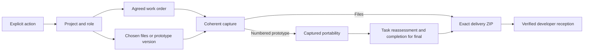

# Designer in the loop architecture

The product is a set of explicitly invoked Agent Skills sharing canonical executable Markdown protocols. See the [specification](../specification.md), [contracts](contracts.md), [recovery](recovery.md), [rationale](rationale.md) and [verification](verification.md).

Project binds the selected local folder to a role and stable transport repository identity. Orders retains agreed scope separately from local progress. Versions manages accumulated design and the working marker. Deliveries captures the selected files or version, verifies portability for a numbered prototype and publishes exact packages. Inbox verifies incoming artifacts and retains receipts.

A designer can select older v1 for delivery while v2 remains the working version. Final delivery evaluates v1 against the saved agreement; it does not infer fulfillment from v2 or current local ticks. Nonfinal sends preserve assignment and keep the order open. Explicit user-repaired capture replacement remains a pre-package transaction under the same UUID/tag.
